<p align="center">
  
</p>

## `SHEET 01` · Summary

Software Engineer II working mostly with **Java and Spring Boot backends**.
I design and build services end to end, and I find out why they fail in production.
Lately I also build with **LLMs and AI agents**.

| | |
|---|---|
| **Role** | Software Engineer II |
| **Strongest at** | Java, backend services, debugging production problems |
| **Also working on** | System design, LLM features, agentic AI |
| **Writing** | [sudoexplain.dev](https://sudoexplain.dev/): production problems explained in plain words |

## `SHEET 02` · Builds

| Part no. | Build | What it is | Made with |
|---|---|---|---|
| `BLD-001` | [**BuildAegis**](https://github.com/princepsr/BuildAegis) | Scans Maven and Gradle projects for vulnerable dependencies and shows results in a web UI | Java, Spring Boot |
| `BLD-002` | [**SmartKhata**](https://github.com/princepsr/SmartKhata) | Offline-first point-of-sale for Indian kirana shops, with a pharmacy mode | Electron, TypeScript |
| `BLD-003` | [**Backend-Interview-Handbook**](https://github.com/princepsr/Backend-Interview-Handbook) | Depth-first reference for Java backend interviews | JavaScript, Handlebars |
| `BLD-004` | [**Sudo Explain**](https://github.com/princepsr/SudoExplain) | My blog: a hand-built site with zero dependencies, deployed on every push | Node.js |

## `SHEET 03` · Selected writing

Each post starts from a real production error and walks to the fix.

- [Connection pool exhausted: `HikariPool-1 Connection is not available`](https://sudoexplain.dev/posts/connection-pool-exhausted/)
- [Java thread deadlock: find it with a thread dump](https://sudoexplain.dev/posts/java-thread-deadlock/)
- [N+1 query problem in Hibernate and JPA](https://sudoexplain.dev/posts/n-plus-one-query-problem/)
- [Idempotency key: stop a retry from charging twice](https://sudoexplain.dev/posts/idempotency-key-double-charge/)
- [LLM hallucinations: diagnose and fix them in production](https://sudoexplain.dev/posts/llm-hallucinations/)

## `SHEET 04` · Bill of materials

```text
 QTY  MATERIAL               USED FOR
 ───  ─────────────────────  ──────────────────────────────────
  ●   Java                   services, tools, the main trade
  ●   Spring Boot            web backends and APIs
  ●   System design          scaling, caching, failure handling
  ●   PostgreSQL             data that has to stay correct
  ●   AI and LLMs            adding model features to products
  ○   Agentic AI             agents that plan and use tools
  ○   JavaScript             web front ends and scripts

  ● everyday   ○ when the job needs it
```

## `SHEET 05` · Contact

- Blog: [sudoexplain.dev](https://sudoexplain.dev/)
- LinkedIn: [linkedin.com/in/princesinghrajput](https://linkedin.com/in/princesinghrajput)
- Email: [singhprince7177@gmail.com](mailto:singhprince7177@gmail.com)

<sub>REV B · drawn by hand, checked by running it</sub>
